# ViewFit 화면별 데이터 입출력 · ERD v4

- 기준: Figma `ViewFit — Design Board` / `01 Home Feed` 페이지 (2026-10-25 확인)
- 분석 화면: 17개. 재생 화면(Watch)은 딥링크 방식으로 바뀌어 제외했습니다.
- 성격: **AI 분석 결과(검토·비교용)**. 교수님 공지에 따라 팀 담당 학생이 직접 작성한 ERD를 기준으로 삼고, 이 문서는 "AI가 확인한 결과"를 설명하는 자료로 사용합니다.

## 1. 화면별 데이터 입출력

| # | 화면 (Figma 프레임) | 입력 (사용자가 넣는 값) | 출력 (화면에 보여 주는 값) | 관련 테이블 |
|---|---|---|---|---|
| 1 | 웹 시작 화면 (로그인) | 이메일, 비밀번호, 이메일 기억하기 | 로그인 결과 | user |
| 2 | 로그인 팝업 | 아이디, 비밀번호, 소셜 로그인(카카오·네이버·Google) | 로그인 결과 | user |
| 3 | 회원가입 | 이메일, 닉네임(2~12자, 중복 확인), 비밀번호·확인, 약관 동의(필수 3 + 선택 1) | 닉네임 사용 가능 여부 | user |
| 4 | 회원가입 완료 안내 | — | 설문 5문항 안내 | — |
| 5 | 맞춤 추천 설문 | 연령대(하나), 직업(하나), 선호 장르(여러 개·"모든 장르가 좋아요"), 비선호 장르(여러 개·"딱히 없어요"), 기억에 남는 작품(검색·추가·삭제) | 장르 12개, 작품 검색 결과(제목·연도·장르·OTT) | survey, genre, preference, watch_history, content |
| 6 | 홈 | (현재 시각), 작품 클릭 | TPO 상황 문구, "20대 대학생 정준교님" 인사, 대표 작품(제목·평균 평점·평가 수·연도·관람 등급·회차·장르·OTT·해시태그), "비슷한 취향 20대 3,241명이 선택", 맞춤 추천 TOP 10(순위 변동), 통합 랭킹 TOP 10, 세대별 교차 평점(20·30·40대) | recommendation, content, rating, ranking, tag, platform, survey |
| 7 | 프로필 메뉴 | 메뉴 선택, 로그아웃 | 닉네임, 연령대·직업, 한 줄 소개, 좋아요 수, 평점 수, 가입 시점 | user, survey, like_content, rating |
| 8 | 내 프로필 | — | 좋아요 수·평점 수·평균 평점, 최근 좋아요 4개, 취향 키워드, 장르 비율, 주로 찾는 시청 상황, 최근 평점 3개(코멘트), 또래와 평점 비교 | user, survey, like_content, rating, preference, tag, watch_history |
| 9 | 좋아요 표시한 작품 | 유형·OTT 필터, 정렬(최근 좋아요순), 좋아요 해제(목록 편집) | 좋아요 목록(포스터·OTT·평균 평점·연도) | like_content, content, content_platform |
| 10 | 나의 평점 | 유형·별점 필터, 정렬(최근 평가순), 평점·감상 수정 | 평점 목록(별점·코멘트·평가일), 평균 평점 | rating, content |
| 11 | 취향 수정 | 설문과 같은 항목 수정, 저장/취소 | 기존 응답 불러오기 | survey, preference, watch_history |
| 12 | 통합 랭킹 | 주간/월간, 유형(영화·시리즈), OTT, 장르 | TOP 3, TOP 100(순위·지수·등락·NEW) | ranking, content, content_platform |
| 13 | 세대별 랭킹 | 연령대(10대~60대 이상), 유형, OTT, 장르 | 연령대별 평균 평점 TOP 30 | rating(계산), content |
| 14 | 맞춤 추천 (TPO) | 상황(혼자 보는 밤·퇴근 후·주말에 함께·가족과 함께·여행이 필요할 때), 유형, OTT, 장르 | TOP 50, 작품별 상황 태그(예: 주말 · 집에서 둘이), 한 줄 큐레이션 | recommendation, tag, content_tag, content |
| 15 | 재방문 추천 피드백 | 별점(0.5점 단위), "아직 못 봤어요", 코멘트(200자) | 지난번 추천 작품 | recommendation, rating |
| 16 | 평점 반영 결과 · 랭킹 변화 | — | 방금 평가한 작품·별점·코멘트, 이전/현재 순위, 주변 순위 | rating, ranking |
| 17 | 최근 관심사 반영 확인 | 반영하기 / 지금 추천 유지 | 기존 선호·비선호 유지 안내 | survey |
| — | 헤더 검색창 | 검색어 | (결과 화면 없음) | content |

## 2. 입출력에서 뽑은 저장 대상

| 화면에서 나온 값 | 저장 위치 | 비고 |
|---|---|---|
| 이메일·닉네임·비밀번호·약관 | `user` | 닉네임 중복 불가(UK) |
| 연령대·직업·"모든 장르"·"딱히 없어요"·최근 관심사 반영 | `survey` | 회원당 1개(1:1) |
| 선호·비선호 장르 | `preference` + `genre` | 장르 하나당 한 행 |
| 기억에 남는 작품 | `watch_history` (source=SURVEY) | |
| 별점·코멘트·수정 | `rating` | 0.5 단위, 코멘트 200자 |
| 좋아요 | `like_content` | **팀 ERD v3에서 삭제했지만 Figma에 있음** |
| 해시태그·상황 태그 | `tag` + `content_tag` | #힐링, "혼자 보는 밤" 등 |
| 한 줄 큐레이션 | `content.tagline` | |
| 맞춤 추천 결과·피드백 | `recommendation` | 재방문 피드백, 추천 순위 변동 |
| 통합 랭킹 지수·등락·주간/월간 | `ranking` | |
| OTT 뱃지·딥링크 | `platform` + `content_platform` | |
| 평균 평점·평가 수·세대별 평점·장르 비율·"3,241명이 선택" | 저장하지 않음 (계산) | rating, recommendation에서 집계 |

## 3. ERD v4 (테이블 14개)

```mermaid
erDiagram
    user ||--|| survey : "1:1 응답"
    user ||--o{ preference : "1:N 장르 선택"
    genre ||--o{ preference : "1:N"
    user ||--o{ rating : "1:N 평가"
    content ||--o{ rating : "1:N"
    user ||--o{ like_content : "1:N 좋아요"
    content ||--o{ like_content : "1:N"
    user ||--o{ watch_history : "1:N 시청"
    content ||--o{ watch_history : "1:N"
    user ||--o{ recommendation : "1:N 추천받음"
    content ||--o{ recommendation : "1:N"
    tag |o--o{ recommendation : "0..1:N 상황"
    content ||--o{ content_genre : "1:N"
    genre ||--o{ content_genre : "1:N"
    content ||--o{ content_platform : "1:N"
    platform ||--o{ content_platform : "1:N"
    content ||--o{ content_tag : "1:N"
    tag ||--o{ content_tag : "1:N"
    content ||--o{ ranking : "1:N"

    user {
        BIGINT user_id PK
        VARCHAR email UK
        VARCHAR password
        VARCHAR nickname UK
        VARCHAR bio
        BOOLEAN marketing_agree
        DATETIME terms_agreed_at
        DATETIME created_at
    }
    survey {
        BIGINT survey_id PK
        BIGINT user_id FK, UK
        VARCHAR age_group
        VARCHAR job
        BOOLEAN like_all_genres
        BOOLEAN no_disliked_genre
        BOOLEAN use_recent_interest
        DATETIME updated_at
    }
    genre {
        BIGINT genre_id PK
        VARCHAR name UK
    }
    preference {
        BIGINT preference_id PK
        BIGINT user_id FK
        BIGINT genre_id FK
        VARCHAR type
    }
    content {
        BIGINT content_id PK
        INT tmdb_id UK
        VARCHAR title
        VARCHAR content_type
        TEXT overview
        VARCHAR tagline
        VARCHAR poster_url
        VARCHAR backdrop_url
        SMALLINT release_year
        VARCHAR age_rating
        SMALLINT episode_count
    }
    content_genre {
        BIGINT content_genre_id PK
        BIGINT content_id FK
        BIGINT genre_id FK
    }
    platform {
        BIGINT platform_id PK
        VARCHAR name UK
        CHAR color_code
    }
    content_platform {
        BIGINT content_platform_id PK
        BIGINT content_id FK
        BIGINT platform_id FK
        VARCHAR watch_url
    }
    tag {
        BIGINT tag_id PK
        VARCHAR name UK
        VARCHAR tag_type
    }
    content_tag {
        BIGINT content_tag_id PK
        BIGINT content_id FK
        BIGINT tag_id FK
    }
    rating {
        BIGINT rating_id PK
        BIGINT user_id FK
        BIGINT content_id FK
        DECIMAL score
        VARCHAR comment
        VARCHAR age_group
        DATETIME created_at
        DATETIME updated_at
    }
    like_content {
        BIGINT like_id PK
        BIGINT user_id FK
        BIGINT content_id FK
        DATETIME created_at
    }
    watch_history {
        BIGINT watch_history_id PK
        BIGINT user_id FK
        BIGINT content_id FK
        VARCHAR source
        VARCHAR place
        VARCHAR companion
        DATETIME watched_at
    }
    recommendation {
        BIGINT recommendation_id PK
        BIGINT user_id FK
        BIGINT content_id FK
        BIGINT tag_id FK
        VARCHAR rec_type
        SMALLINT rec_rank
        VARCHAR feedback_status
        DATETIME recommended_at
    }
    ranking {
        BIGINT ranking_id PK
        BIGINT content_id FK
        VARCHAR period
        SMALLINT rank_no
        SMALLINT previous_rank
        DECIMAL score_index
        DATE ranked_date
    }
```

### 컬럼 설명 (값이 정해진 것)

| 테이블.컬럼 | 값 |
|---|---|
| survey.age_group | 14–19세, 20대, 30대, 40대, 50대, 60대 이상, 응답 안 함 |
| survey.job | 학생, 직장인, 자영업·프리랜서, 가사·돌봄, 구직·휴직 중, 기타 |
| preference.type | LIKE / DISLIKE |
| content.content_type | MOVIE / SERIES |
| tag.tag_type | MOOD(#힐링 등) / SITUATION(혼자 보는 밤 등) |
| rating.score | 0.5 ~ 5.0, 0.5 단위 |
| rating.age_group | 평가 당시 연령대 (세대별 랭킹용) |
| watch_history.source | SURVEY(설문 입력) / OTT(딥링크 이동 후) |
| recommendation.rec_type | PERSONAL(맞춤) / TPO(상황) |
| recommendation.feedback_status | PENDING / RATED / NOT_WATCHED |
| ranking.period | WEEKLY / MONTHLY |

### 복합 유니크

- preference (user_id, genre_id) · rating (user_id, content_id) · like_content (user_id, content_id)
- content_genre (content_id, genre_id) · content_platform (content_id, platform_id) · content_tag (content_id, tag_id)
- ranking (period, ranked_date, rank_no)
- survey.user_id 는 UK (1:1)

## 4. ERD v3 대비 바뀐 점

| 구분 | 내용 | 근거 화면 |
|---|---|---|
| 추가 | `like_content` (좋아요) | 좋아요 표시한 작품, 프로필 메뉴, 내 프로필 |
| 추가 | `tag`, `content_tag` | 홈 해시태그, 맞춤 추천 상황 필터·상황 태그, 프로필 취향 키워드 |
| 추가 | `recommendation` | 재방문 추천 피드백, 맞춤 추천 순위 변동 |
| 컬럼 추가 | user.nickname UK, user.bio, user.terms_agreed_at | 회원가입 중복 확인, 프로필 한 줄 소개 |
| 컬럼 추가 | survey.like_all_genres, no_disliked_genre, use_recent_interest | 설문, 최근 관심사 반영 확인 |
| 컬럼 추가 | rating.comment, rating.updated_at | 나의 평점(감상·수정), 재방문 피드백 |
| 컬럼 추가 | content.tagline, backdrop_url, age_rating, episode_count | 홈 대표 작품, 맞춤 추천 한 줄 큐레이션 |
| 컬럼 변경 | watch_history.occasion → companion, source 추가 | 상황 태그(혼자·둘이·가족과), 설문 입력 구분 |
| 컬럼 추가 | ranking.period, score_index | 통합 랭킹 주간/월간·지수 |

## 5. 팀이 정해야 할 것

1. **좋아요 기능 유지 여부**: Figma에는 있고 ERD v3에서는 삭제했습니다. 유지하면 `like_content`를 쓰고, 빼면 Figma 화면 3곳을 정리해야 합니다.
2. **로그인 화면 통일**: 웹 시작 화면은 이메일, 로그인 팝업은 아이디 + 소셜 로그인입니다. 소셜 로그인을 넣으려면 소셜 계정 테이블이 하나 더 필요합니다.
3. **TPO 장소·동행 입력**: 상황 태그는 작품 쪽에는 있지만, 사용자의 장소·동행을 입력받는 화면은 아직 없습니다.
4. **헤더 검색 결과 화면**: 검색창은 있지만 결과 화면이 없습니다.
