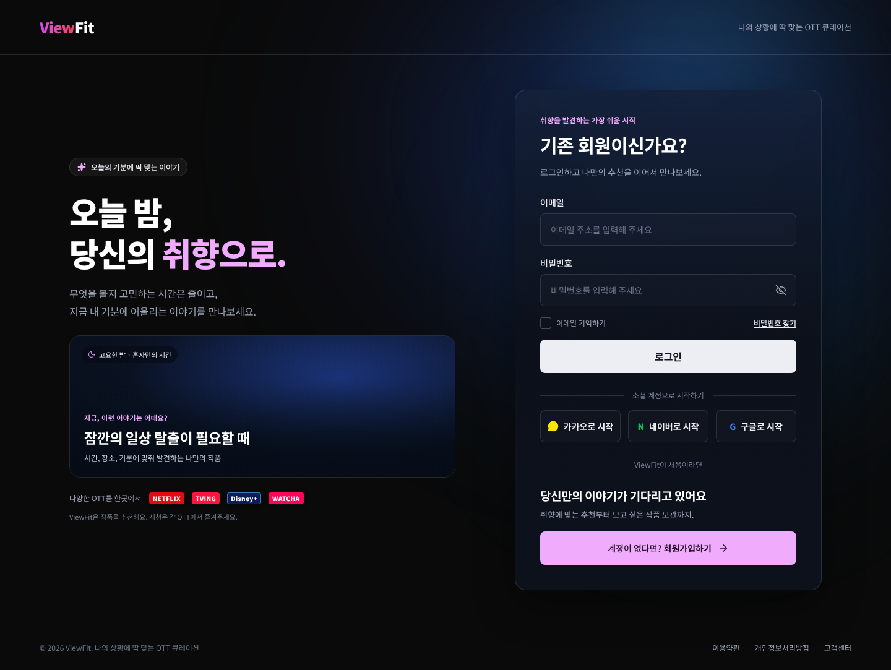
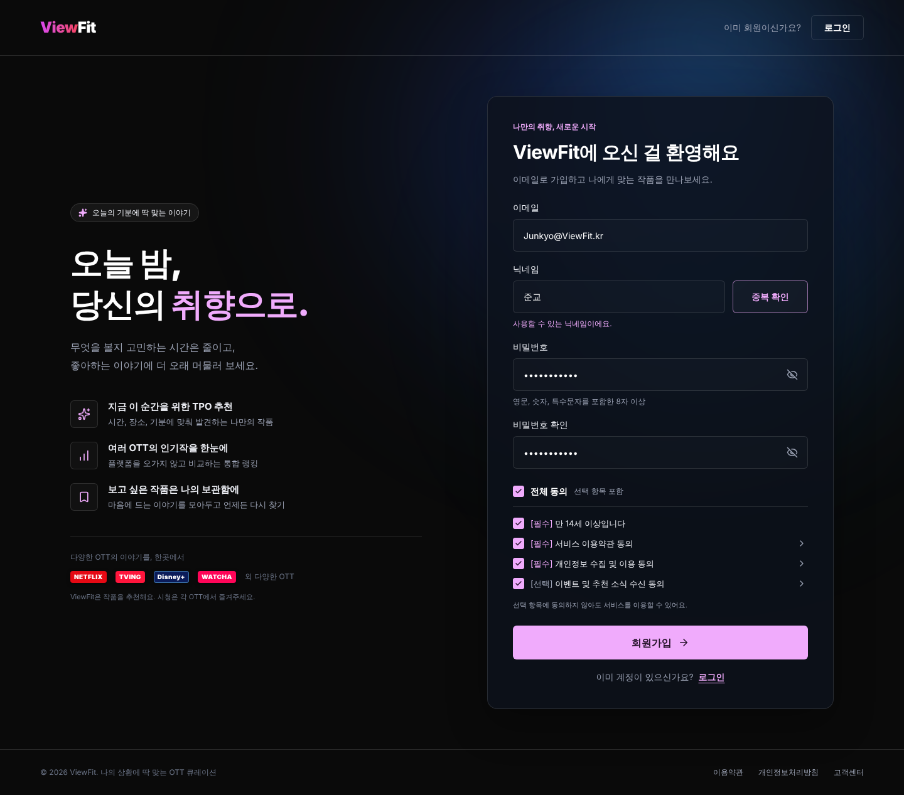
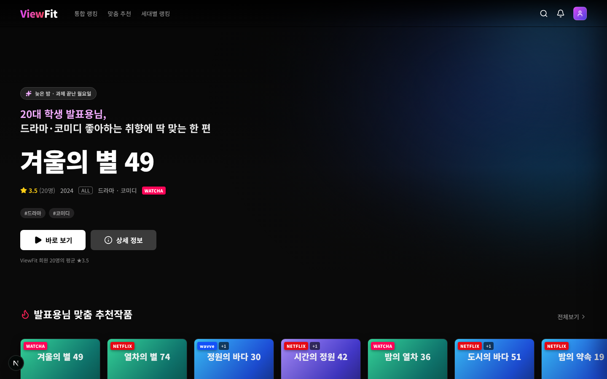
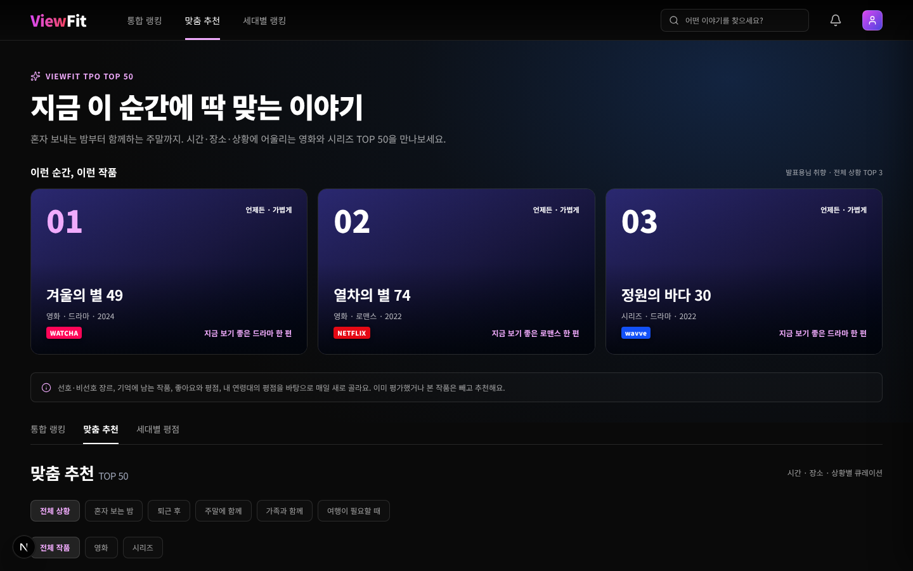
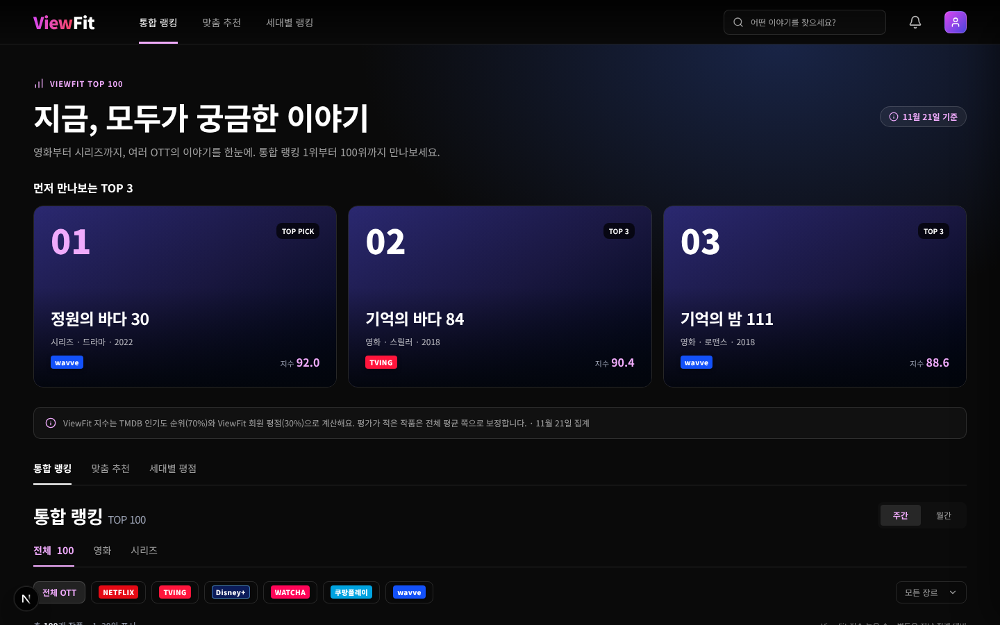
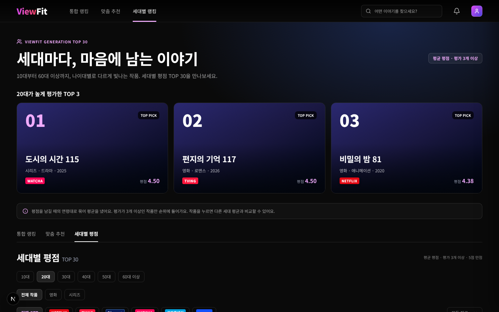
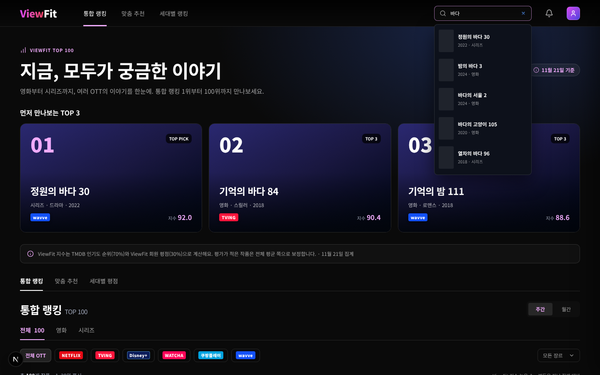
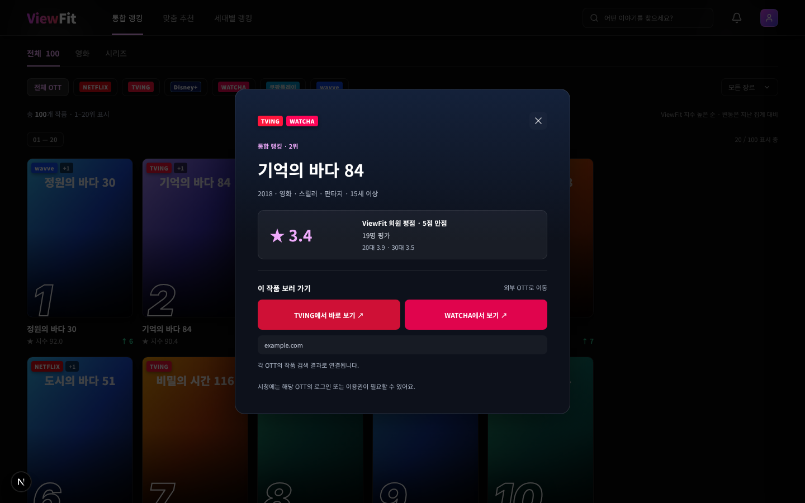

# ViewFit 중간 발표

**지금 내 상황과 취향에 맞는 OTT 작품을 한곳에서**
2026. 11. 24. · 정준교 · 홍준화 · 정재준 · Next.js + Django + MariaDB · TMDB API

> 🎤 안녕하세요, ViewFit 팀입니다. 오늘은 개발 환경 → 프로그램 목록과 진도율 → 주차별 진행 → PRD와 실행 결과 → GitHub 순서로 말씀드리고, 마지막에 실제 사이트를 시연하겠습니다.

---

## 1. 프로젝트 소개

넷플릭스 · 티빙 · 쿠팡플레이 · 웨이브 · 디즈니+ · 왓챠의 영화와 시리즈를 한곳에서 추천하는 큐레이션 웹 서비스

| 핵심 기능 | 내용 |
|---|---|
| ① 상황(TPO) 맞춤 추천 | 설문 취향 + 지금 시간대·상황으로 오늘 볼 작품 TOP 50 |
| ② 통합 OTT 랭킹 | 여러 OTT의 인기 작품을 하나의 TOP 100으로 |
| ③ 세대별 평점 | 10대~60대 이상, 세대마다 높게 평가한 TOP 30 |
| ④ OTT 바로가기 | 작품을 고르면 그 작품이 있는 OTT로 바로 이동 |

> 🎤 여러 OTT에 흩어진 작품을 한곳에서 보고, 지금 내 상황과 취향에 맞는 작품을 추천받는 서비스입니다. 핵심 기능은 상황 맞춤 추천, 통합 랭킹, 세대별 평점, OTT 바로가기 네 가지입니다.

---

## 2. 개발 환경

| 구분 | 사용 기술 | 비고 |
|---|---|---|
| 프론트엔드 | Next.js 16 · React 19 · TypeScript · Tailwind CSS 4 | Figma 화면 16개 기준 |
| 백엔드 | Python 3.12 · Django 5.2 · Django REST Framework | REST API 19개 (/api/v1) |
| DBMS | MariaDB (utf8mb4) | 테이블 14개 · 물리 ERD |
| 외부 API | TMDB API — 작품 · 포스터 · 한국 OTT 제공처 · 관람 등급 · 인기도 | 화면 하단 출처 표기 |
| 인증 | DRF 토큰 인증 · 비밀번호 해시 저장 | Authorization: Token |
| 서버 | 개발: 각자 PC (localhost:3000 / 8000) · 배포: AWS EC2 + RDS | 배포 11/28~29 예정 |
| 개발 도구 | VS Code · GitHub · Figma · HeidiSQL · Notion · Claude Code | 바이브 코딩 |

### 시스템 구조

```
[사용자 브라우저] ──▶ [Next.js 프론트엔드 :3000] ◀──▶ [Django + DRF :8000] ◀──▶ [MariaDB · 테이블 14개]
        │                                              ▲                              ┆
        │ 바로 보기(딥링크, 새 탭)                       │ import_tmdb · build_rankings  ┆ 배포(예정)
        ▼                                              │                              ▼
   [OTT 6개 작품 검색 화면]                        [TMDB API]                   [AWS EC2 + RDS]
```

### 사용한 오픈 소스 · 외부 API

| 이름 | 용도 |
|---|---|
| Next.js · React | 화면 라우팅 · 컴포넌트 (MIT) |
| Tailwind CSS · lucide-react | Figma 그대로의 스타일 · 아이콘 (MIT · ISC) |
| Django · Django REST Framework | 백엔드 · REST API · 토큰 인증 (BSD) |
| mysqlclient · django-cors-headers · python-dotenv | MariaDB 연결 · 프론트 요청 허용 · 비밀 키를 코드와 분리 |
| TMDB API | 작품 정보 · 포스터 · 한국 OTT 제공처 · 인기도 |
| Noto Sans KR · Playwright | 한글 글꼴 (OFL) · 브라우저 자동 확인 |

> 🎤 프론트엔드는 Next.js·React·TypeScript, 백엔드는 Django와 DRF로 API 19개를 만들었고, DB는 MariaDB 테이블 14개입니다. 작품 정보는 TMDB API에서 가져옵니다. 지금은 각자 PC에서 개발하고 11월 28~29일에 AWS로 배포합니다. 코드는 Claude Code로 바이브 코딩했습니다.

---

## 3. 개발 방식

**① 프로그램 목록** (9개, 세부 15개) → **② PRD 작성** (목적·기능·API·완료 기준) → **③ Step 프롬프트** → **④ 바이브 코딩** (Claude Code) → **⑤ 완료 기준 확인** (테스트·브라우저·Figma 비교)

| 협업 방법 | 내용 |
|---|---|
| 공용 브랜치 하나 | 세 명 모두 같은 브랜치에서 받기 → 작업 → 올리기 |
| CLAUDE.md | 팀원의 Claude가 작업 전에 자동으로 읽는 팀 규칙 |
| 작업 일지 · 프롬프트 기록 | 누가 무엇을 요청했고 무엇이 만들어졌는지 남김 (docs/WORKLOG.md, docs/prompts) |

> 🎤 교수님께서 안내해 주신 대로 기능을 프로그램 목록으로 나누고, 프로그램마다 PRD를 쓰고, 단계별 프롬프트로 바이브 코딩한 뒤 완료 기준으로 확인합니다. 세 명이 각자 Claude를 쓰다가 같은 기능을 두 번 만든 적이 있어서, 공용 브랜치를 하나로 정하고 CLAUDE.md로 팀원의 Claude가 팀 규칙과 최근 작업 일지를 먼저 읽게 했습니다.

---

## 4. 프로그램 목록표

| 번호 | 프로그램 | 기능 | 개발자 | 진도율 |
|---|---|---|---|---|
| 0 | 공통 기반 | 개발 환경 · DB 14개 테이블 · 공통 화면 틀과 부품 | 3명 공동 | 90% |
| 1 | 회원관리 | 회원가입 · 닉네임 중복 확인 · 로그인 · 로그아웃 | 정준교 | 95% |
| 2 | 작품 데이터 | TMDB 작품 수집 · OTT 연결 · 시연용 평점 | 홍준화 | 90% |
| 3 | 취향 설문 | 연령대 · 직업 · 선호/비선호 장르 · 기억에 남는 작품 | 홍준화 | 100% |
| 4 | 작품 탐색 | 통합 검색 · 작품 상세 팝업 · OTT 바로가기 | 정재준 | 85% |
| 5 | 평가 · 좋아요 | 별점 · 감상 · 나의 평점 · 좋아요 목록 | 정준교 | 10% |
| 6 | 랭킹 | 통합 랭킹 TOP 100 · 세대별 평점 TOP 30 | 정준교 | 95% |
| 7 | AI 추천 | 상황 맞춤 추천 TOP 50 · 재방문 피드백 | 홍준화 | 90% |
| 8 | 마이페이지 | 프로필 · 취향 수정 · 최근 관심사 반영 | 정재준 | 30% |

**전체 진도율 76%** (9개 프로그램 평균, 11/23 기준) — 남은 것: 5번 평가·좋아요, 8번 마이페이지

> 🎤 0번은 셋이 함께, 1·5·6번은 정준교, 2·3·7번은 홍준화, 4·8번은 정재준이 맡았습니다. 진도율은 각 PRD의 기능 요구사항과 완료 기준 중 끝난 비율입니다. 핵심 흐름인 설문·랭킹·추천은 동작하고, 평가·좋아요와 마이페이지가 이번 주에 남은 부분입니다. 회원관리의 남은 5%는 선택 기능인 소셜 로그인, 작품 데이터의 10%는 디즈니+ 바로가기 주소 수정입니다.

---

## 5. 주차 보고서

| 기간 | 한 일 | 결과 |
|---|---|---|
| ~ 11/9 | 주제 선정 · Figma 화면 16개 · ERD(개념→물리) · 개발 환경 | 설계 완료 |
| 11/10 ~ 16 | 공통 화면 틀·부품, 회원가입·로그인 API, 프로그램 목록·PRD 15개 | 0번 · 1번 완료 |
| 11/17 ~ 23 | TMDB 수집, 설문, 검색·상세, 통합·세대별 랭킹, 맞춤 추천, 재방문 피드백 | 2 · 3 · 6 · 7번 완료 |
| 11/24 ~ 30 | 평가·좋아요, 마이페이지, 홈 세대별 교차 평점, AWS 배포 | 예정 |
| 12/1 ~ 8 | 전체 점검·버그 수정, 12/3 기능 동결, 시연 영상, 12/8 최종 발표 | 예정 |

> 🎤 11월 9일까지 설계, 그다음 주에 0번 공통 기반과 1번 회원관리, PRD 15개. 지난주에 작품 데이터·설문·검색·랭킹·추천까지 진행했습니다. 이번 주에 평가·좋아요·마이페이지·배포를 하고 12월 3일에 기능을 멈춥니다.

---

## 6. PRD 예시 — 6-1 통합 랭킹

**모든 PRD는 같은 8개 항목:** 목적 · 사용자 이야기 · 기능 요구사항(FR) · 데이터·API · 규칙·예외 · 완료 기준 · 범위 밖 · 바이브 코딩 프롬프트(Step)

| 6-1에서 정한 것 | 내용 |
|---|---|
| ViewFit 지수 | 70 × TMDB 인기도 순위 + 30 × 보정 평점 / 5 (평가가 1~2개뿐인 작품이 1위가 되지 않게 보정) |
| API | `GET /api/v1/rankings/?period=weekly&type=movie&platform=NETFLIX` |
| Step 4개 | 점수 칸 → 집계 명령 → 랭킹 API → 화면 |
| 완료 기준 | TOP 100 저장 ✅ · 날짜 바꿔 순위 변동 ✅ · 필터 후 1위부터 다시 번호 ✅ · 홈 TOP 10과 같음 ✅ |

> 🎤 PRD 예시로 6-1 통합 랭킹입니다. 지수 계산식, API 주소, 4단계 프롬프트를 정해 두고 완료 기준을 하나씩 확인했습니다. 실제 TMDB 데이터로 통합 랭킹 TOP 10과 홈 TOP 10이 같은 것까지 확인했습니다. (GitHub의 docs/prd 폴더를 열어 보여 주기)

---

## 7. 실행 결과

### ① 회원관리 (1번) — 웹 시작 화면 · 회원가입





이메일 로그인 · 이메일 기억하기 · 닉네임 중복 확인 · 비밀번호 해시 저장

### ② 홈 · 맞춤 추천 (3번 · 7번)





"20대 학생 OO님" + 시간대 문구 + 오늘의 추천 · 상황 5개로 거르는 맞춤 추천 TOP 50 · 이미 평가했거나 본 작품은 빼고 추천

### ③ 랭킹 (6번) — 통합 랭킹 · 세대별 평점





주간/월간 · 순위 변동 ↑↓ NEW · 평가할 당시 연령대로 평균 · 평가 3개 이상만

### ④ 검색 · 상세 · OTT 바로가기 (4번)





2글자부터 검색 · 세대별 평균 비교 · OTT 버튼 → 새 탭 + 시청 기록 · OTT가 작품별 주소를 공개하지 않아 각 OTT의 작품 검색 화면으로 연결

> 💡 화면 속 작품 이름은 테스트 데이터입니다. 실제 TMDB 작품은 시연에서 보여 드립니다.

> 🎤 실행 화면입니다. 로그인하지 않으면 웹 시작 화면, 가입 후 설문, 홈에서 시간대와 취향에 맞는 추천, 통합 랭킹과 세대별 평점, 상단 검색과 상세 팝업, 그리고 OTT 버튼으로 해당 OTT가 새 탭에 열립니다.

---

## 8. 검증

| 숫자 | 내용 |
|---|---|
| **81** | 자동 테스트 모두 통과 (`python manage.py test core`, SQLite·MariaDB) |
| **19** | REST API (/api/v1) |
| **14** | DB 테이블 (물리 ERD) |
| **16** | Figma 기준 화면 |

- 세대별 평점 1~3위 평균 = HeidiSQL에서 SQL로 직접 계산한 값
- 통합 랭킹 TOP 10 = 홈 화면 TOP 10 (실제 TMDB 작품, 팀원 PC)
- OTT 바로가기 6개를 직접 열어 봄 → 디즈니+ 주소 오류 발견, 수정 예정

---

## 9. GitHub

**https://github.com/jungyojeong16-arch/team-project** · 공용 브랜치 `claude/viewfit-project-planning-qiqv1h`

| 위치 | 내용 |
|---|---|
| app/ | Next.js 화면 · 공통 부품 (app/_components) |
| backend/ | Django API · 테이블(models.py) · 자동 테스트(tests.py) |
| docs/prd/ | 프로그램 목록표 · PRD 15개 · 단계별 프롬프트 |
| docs/prompts/ | 프로그램별 프롬프트 사용 기록 · 실행 화면 |
| docs/WORKLOG.md · CLAUDE.md | 누가 무엇을 했는지 작업 일지 · 팀 규칙 |

커밋 70개+ · 세 명 모두 커밋 · .env와 API 키는 올리지 않음 (공개 저장소)

---

## 10. 남은 일정

| 날짜 | 할 일 | 담당 |
|---|---|---|
| 11/25 ~ 26 | 5-1 평점 · 5-2 좋아요 (상세 팝업의 별점·하트 연결) | 정준교 |
| 11/27 | 8-1 프로필 · 취향 수정 | 정재준 |
| 11/28 ~ 29 | AWS 배포 (EC2 + RDS) | 정준교 |
| 11/30 ~ 12/2 | 배포 사이트 전체 점검 · 디즈니+ 바로가기 · 버그 수정 | 3명 공동 |
| 12/3 | 기능 동결 · 시연 영상 녹화(백업) | 3명 공동 |
| 12/8 | 최종 발표 | 3명 공동 |

위험 대비: 배포가 늦어지면 노트북에서 로컬로 시연 · 시간이 모자라면 소셜 로그인 · 최근 관심사 반영(P2)부터 뺌

---

## 11. 시연 · 질문

**시연 순서:** 로그인 → 홈 추천 → [바로 보기]로 OTT 새 탭 → 통합 랭킹 (영화 + 넷플릭스 필터, 펼치기) → 세대별 평점 (20대 → 40대) → 상단 검색 → GitHub

> ⚠️ 시연 때 디즈니+ 작품은 누르지 않기 (바로가기 주소 수정 전). 티빙·웨이브·왓챠 작품으로 시연.

### 예상 질문과 답

**Q. 바로가기가 작품 페이지로 바로 가나요?**
OTT들이 작품별 공식 주소를 공개하지 않아서 각 OTT의 작품 검색 결과로 연결합니다. 티빙·웨이브·왓챠는 검색 결과에 바로 나오고, 넷플릭스·쿠팡플레이는 로그인 후 이어집니다.

**Q. AI 추천은 어떻게 하나요?**
설문의 선호·비선호 장르, 기억에 남는 작품, 좋아요·평점, 같은 연령대 평점, 지금 상황(TPO)을 점수로 합쳐 순위를 냅니다. 한 줄 추천 이유는 지금은 정해진 문장 틀이고, LLM API는 비용과 키 문제로 팀 결정 후 붙일 예정입니다.

**Q. 평점 데이터가 적지 않나요?**
시연용 가상 회원 60명의 평점을 만들어 쓰고, 화면에 "시연용 가상 평점이 포함되어 있어요"라고 표시합니다.

**Q. 세대별 평점을 회원 나이로 묶지 않은 이유는?**
해가 바뀌면 회원 연령대가 바뀌어 과거 평가가 다른 세대로 옮겨 가기 때문에, 평가할 당시 연령대를 따로 저장합니다.

**Q. 바이브 코딩에서 사람이 한 일은?**
기능을 프로그램 목록과 PRD로 정하고, Step 프롬프트로 요청하고, 완료 기준으로 직접 확인하고, 틀린 부분은 수정 요청을 보냈습니다. 기록은 GitHub docs/prompts에 있습니다.
