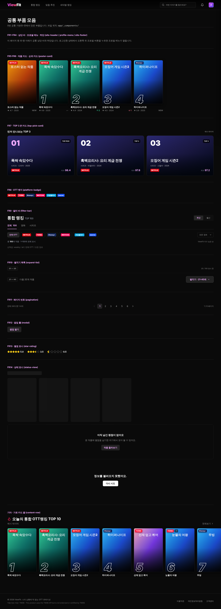
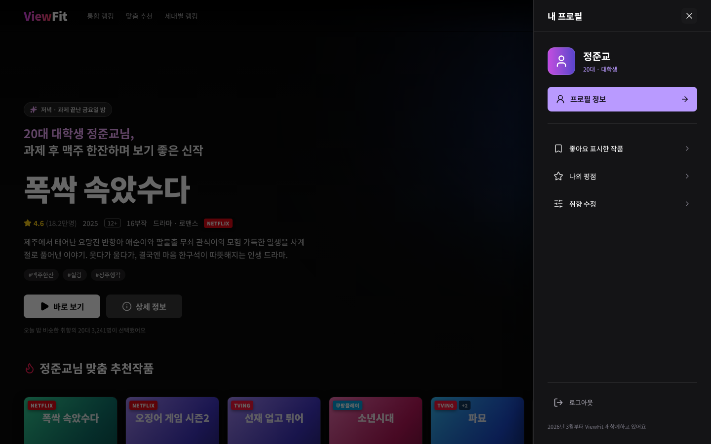
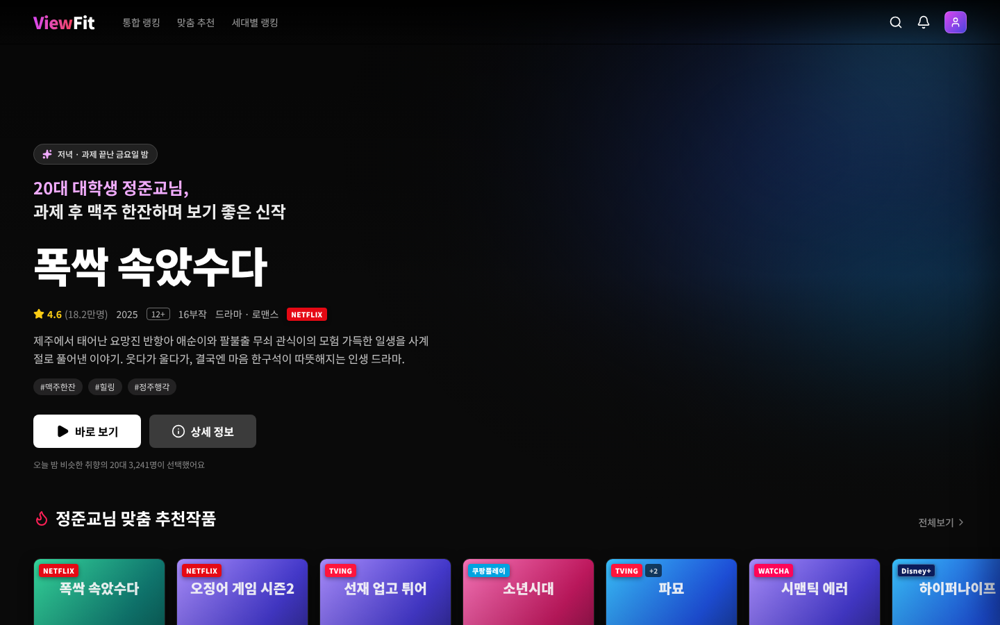

# 0 공통 기반 — 프롬프트 사용 기록

- PRD: [docs/prd/0_common_base.md](../prd/0_common_base.md), [docs/prd/0-4_home.md](../prd/0-4_home.md)
- 요청·확인: 정준교 / 코드 작성: AI(Claude Code)
- 커밋 주소: `https://github.com/jungyojeong16-arch/team-project/commit/<커밋 번호>`

---

### 기록 1 — 0-1 개발 환경 · DB 스키마
| 칸 | 내용 |
|---|---|
| 날짜 | 11/3 |
| 보낸 프롬프트 | "그럼 어차피 발표가 12월 중순이니까 12월 초에 한 번 해보고 지금은 이제 무엇을 하면 되는지 알려줘" → "그럼 지금 주차에 해야할 일을 해줘." |
| 기준 PRD | 0-1 개발 환경·DB 스키마 (프론트 TypeScript·Next.js / 백엔드 Python·Django / DBMS MariaDB) |
| AI가 한 일 | 최종 개념 ERD를 물리 설계로 바꿔 **테이블 14개**(Django 모델) 작성, 중복 금지·별점 0.5 단위 같은 DB 규칙 추가, 기본 데이터(장르 12·OTT 6·상황 5) 자동 입력, 백엔드 실행 설명서 작성, 물리 ERD 그림·설명 문서 작성 |
| 결과 | 커밋 [`f1ef0bd`](https://github.com/jungyojeong16-arch/team-project/commit/f1ef0bd) · `backend/` 전체, `docs/erd/ViewFit_ERD_physical.md`·`.drawio` |
| 확인 | - [x] `python manage.py migrate` 로 테이블 14개 생성 (MariaDB)   - [x] http://127.0.0.1:8000/api/v1/health/ 에 `"database": "mysql"` 와 기본 데이터 개수 표시   - [x] 정준교 PC에서 직접 실행 확인 (11/10, 아래 기록 2) |
| 수정 요청 | 없음 |

### 기록 2 — 0-1 정준교 PC 세팅 확인
| 칸 | 내용 |
|---|---|
| 날짜 | 11/10 |
| 보낸 프롬프트 | "그럼 지금 해야하는 거 알려줘. …" → (ZIP 적용·설치 단계마다 질문) → "다 됐음." / "그러면 방금 회원가입 하고 유저 프로필 보는 것과 superuser로 로그인 후 프로필 보는 작업까지 된 것을 확인 했는데 …" |
| 기준 PRD | 0-1 완료 기준 "가입 → 설문 → 프로필까지 동작" |
| AI가 한 일 | 설치 순서 안내 (Python 3.12 · MariaDB DB 만들기 · 가상환경 · migrate · runserver · npm run dev · `.env.local`) |
| 결과 | 코드 변경 없음 |
| 확인 | - [x] 정준교 PC: 백엔드·프론트 동시 실행, 회원가입 → 프로필, 관리자 계정으로 로그인 확인   - [ ] 홍준화·정재준 PC 세팅 |
| 수정 요청 | 없음 (MariaDB가 이미 설치돼 있어 설치 단계 생략) |

### 기록 3 — 0-2 공통 규칙 초안 · 0번 구조 정리
| 칸 | 내용 |
|---|---|
| 날짜 | 11/10 |
| 보낸 프롬프트 | "이거는 우리 팀장이 올린 것인데 0번부터 해서 0번을 기반으로 큰 틀을 짜고 그 밑에 1번부터 세세하게 해야한다는데 맞아?" → "선호 ott라는 것은 내가 볼 땐 선호 장르 등을 말한 것 같아. 그리고 어차피 우리 피그마와 ERD를 기준으로 해당 목록표를 짜는 거니까 아까 올려준 목록표를 팀장이 올려준 것처럼 큰 틀로 다같이 구성할 것을 먼저 0순위로 하고 그 뒤에 가지를 쳐서 각자 팀원들마다 맡아야 할 부분을 정하는 게 나을 거 같아." |
| 기준 PRD | 프로그램 목록(README), 0-2 공통 규칙 |
| AI가 한 일 | PRD를 0번 공통 기반 + 1~8번 구조로 재정리, 0-2 공통 규칙(폴더·API·이름·GitHub) 초안 작성, Figma·ERD에 없는 페르소나·대화형 설문 제외 |
| 결과 | 커밋 [`2f39ac5`](https://github.com/jungyojeong16-arch/team-project/commit/2f39ac5) (PRD 첫 작성), [`b998b00`](https://github.com/jungyojeong16-arch/team-project/commit/b998b00) (0~8번 구조) |
| 확인 | - [x] 정준교 확인   - [ ] 팀원 확인 (0-2 확정) |
| 수정 요청 | 없음 |

### 기록 4 — 0-3 공통 레이아웃·부품, 0-4 홈 화면 틀
| 칸 | 내용 |
|---|---|
| 날짜 | 11/10 |
| 보낸 프롬프트 | "그럼 0번 공통 기반 바로 시작해줘" |
| 기준 PRD | 0-3 Step 1 (상단 바·프로필 메뉴·하단), 0-3 Step 2 (공통 부품), 0-4 Step 0 (홈 화면 틀) |
| AI가 한 일 | Figma에서 상단 바(144:6422)·프로필 메뉴(40:1850)·하단(144:7990)·TOP 3 카드·필터·순위 카드·펼치기 디자인 값을 읽어 공통 부품 13종 제작, 부품 모음 페이지 `/dev/components`, 메뉴용 "준비 중" 화면 6개, 홈을 영역별 부품으로 나눔 |
| 결과 | 커밋 [`0f04d58`](https://github.com/jungyojeong16-arch/team-project/commit/0f04d58) · `app/_components/` (site-header, profile-menu, site-footer, site-shell, poster-card, top-pick-card, platform-badge, filter-bar, expand-list, pagination, modal, star-rating, status-view, content-row, coming-soon, home/…), `app/_lib/catalog.ts` |
| 확인 | - [x] 타입 검사·빌드 통과   - [x] 브라우저에서 홈·프로필 메뉴·부품 모음 페이지 확인 (아래 캡처)   - [ ] 정재준 화면 검수 |
| 수정 요청 | 테스트 중 포스터 사진을 못 불러오면 깨진 글자가 보이는 문제 → 색 배경으로 대신하도록 AI가 바로 수정 |

### 기록 5 — 0-4 홈 화면을 Figma와 똑같이 (수정 요청)
| 칸 | 내용 |
|---|---|
| 날짜 | 11/16 |
| 보낸 프롬프트 | "첫 번째 사진은 figma 사진이고 두 번째 사진은 localhost로 열은 홈페이지 사진인데 둘이 다르지? figma와 모든 내용이 다 똑같게 해줘." (Figma 캡처 + localhost 캡처 첨부) |
| 기준 PRD | 0-4 완료 기준 "화면이 Figma 9:5 와 같다", 0-3 FR1·FR4 |
| AI가 한 일 | 원인 확인 (내 PC가 예전 코드 + 최신 코드에도 남은 차이) → Figma 9:6·9:50·9:72 값을 다시 읽어 홈 전용 상단 바(돋보기 아이콘)·하단 추가, 오늘의 추천 높이 720·빛 번짐 배경·제목 60px, 카드 줄 간격, Figma 글꼴(Noto Sans KR) 적용, 예시 포스터를 Figma처럼 색 배경으로 |
| 결과 | 커밋 [`fd5f1ca`](https://github.com/jungyojeong16-arch/team-project/commit/fd5f1ca) · `app/_components/site-header.tsx`, `site-footer.tsx`, `site-shell.tsx`, `viewfit-font.tsx`, `home/today-pick.tsx`, `home/home-rows.tsx`, `content-row.tsx`, `poster-card.tsx`, `app/page.tsx` |
| 확인 | - [x] 같은 크기로 찍어 Figma 9:5 와 비교 (아래 캡처) |
| 수정 요청 | 이 기록 자체가 수정 요청 |

### 기록 6 — 0-1 설정 파일 GitHub 업로드와 같은 환경 확인
| 칸 | 내용 |
|---|---|
| 날짜 | 11/16 |
| 보낸 프롬프트 | "파일 3개를 깃허브에 올리는 방법을 알려줘" → (정준교가 직접 업로드) → "다 올렸는데 한 번 확인해주고 확인 되었다면 깃허브에 있는 코드에 내용과 피그마의 내용을 비교해줘." |
| 기준 PRD | 0-1 (팀원도 GitHub만 받으면 실행 가능하게) |
| AI가 한 일 | 올린 8개 파일 확인(비밀 정보 없음), 같은 설정(Next.js 16·Tailwind 4)으로 설치·빌드, Figma 16개 화면과 비교표 작성 |
| 결과 | 정준교 업로드 커밋 [`89394d8`](https://github.com/jungyojeong16-arch/team-project/commit/89394d8), [`36564f9`](https://github.com/jungyojeong16-arch/team-project/commit/36564f9) · `package.json`, `package-lock.json`, `tsconfig.json`, `next.config.mjs`, `postcss.config.js`, `tailwind.config.js`, `app/layout.tsx`, `app/globals.css` |
| 확인 | - [x] 오류 없이 빌드   - [x] 만든 화면 6개 Figma와 같음, 설문·프로필은 다름(3번·8번에서 수정), 나머지 8개는 미제작 |
| 수정 요청 | 남은 것: `layout.tsx` 언어(ko)·밝은 모드 흰 배경, `public` 폴더 업로드 |

### 기록 7 — 0-1 DB 칸 추가 (팀 결정 D6·D7 반영)
| 칸 | 내용 |
|---|---|
| 날짜 | 11/17 |
| 보낸 프롬프트 | "그럼 이제 docs/prd/readme.md에 있는 0~8번 내용에서 0번부터 실행하자." |
| 기준 PRD | 0-1 DB 스키마 · README 5번 D6·D7 → 해당 Step 프롬프트: **2-1 Step 4** ("DB 담당이 D6 을 승인했어. content 에 backdrop_url, age_rating, runtime_minutes, episode_count, tmdb_rating, tmdb_vote_count 칸을 추가하는 migration 을 만들고 import_tmdb 에서 채워 줘. docs/erd/ViewFit_ERD_physical.md 의 content 칸 목록도 같이 고쳐 줘.") · **6-1 Step 1** ("DB 담당이 D7 을 승인했어. ranking 테이블에 score DECIMAL(5,1) 칸을 추가하는 migration 을 만들고, docs/erd/ViewFit_ERD_physical.md 의 ranking 칸 목록에 score 와 '집계 당시 값이라 저장' 이유를 적어 줘.") |
| AI가 한 일 | 0번에서 남은 일 중 코드로 할 수 있는 DB 칸 추가(D6·D7)를 DB 담당(정준교) 요청으로 진행. `content` 에 6칸, `ranking` 에 `score` 추가(`0004` migration). `import_tmdb` 가 TMDB 배경 이미지·KR 관람 등급·상영 시간·회차·TMDB 평점을 저장. 작품 카드 API·프론트 `Movie` 타입을 새 칸에 맞춤(등급 없으면 표시 안 함). ERD 문서·PRD 상태 갱신 |
| 결과 | 커밋 [`451b5ff`](https://github.com/jungyojeong16-arch/team-project/commit/451b5ff) · `backend/core/models.py`, `migrations/0004_content_card_fields_ranking_score.py`, `tmdb.py`, `serializers.py`, `tests.py`, `app/_lib/viewfit.ts`, `docs/erd/ViewFit_ERD_physical.md` |
| 확인 | - [x] `python manage.py test core` 25개 통과 (SQLite, MariaDB 둘 다)   - [x] MariaDB `show columns` 로 새 칸 7개 확인 (`score decimal(5,1)`)   - [x] 프론트 타입 검사 통과   - [ ] 정준교 PC에서 `migrate` → HeidiSQL로 칸 확인   - [ ] `import_tmdb` 다시 실행 → 새 칸이 채워지는지 |
| 수정 요청 | 없음 |
