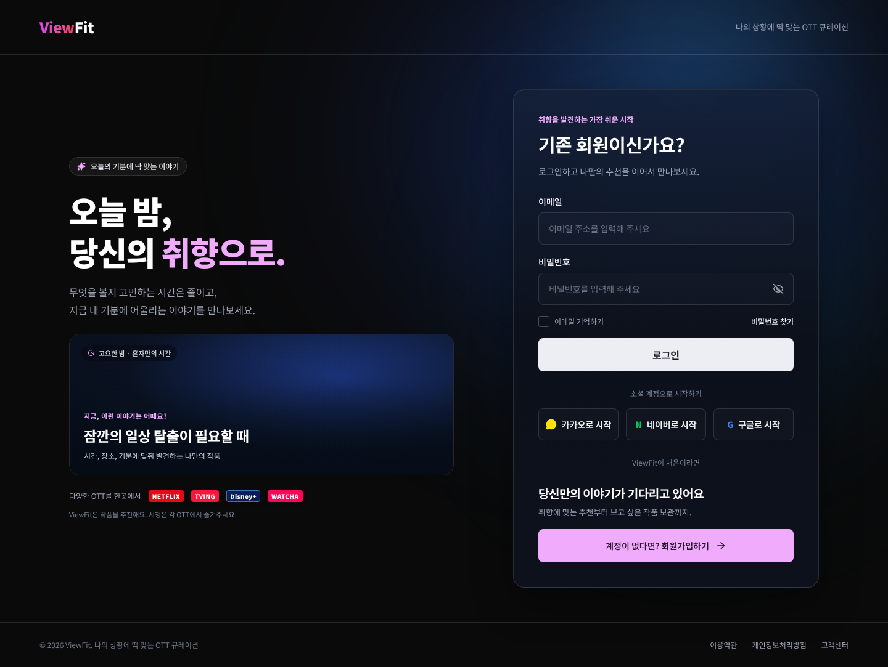
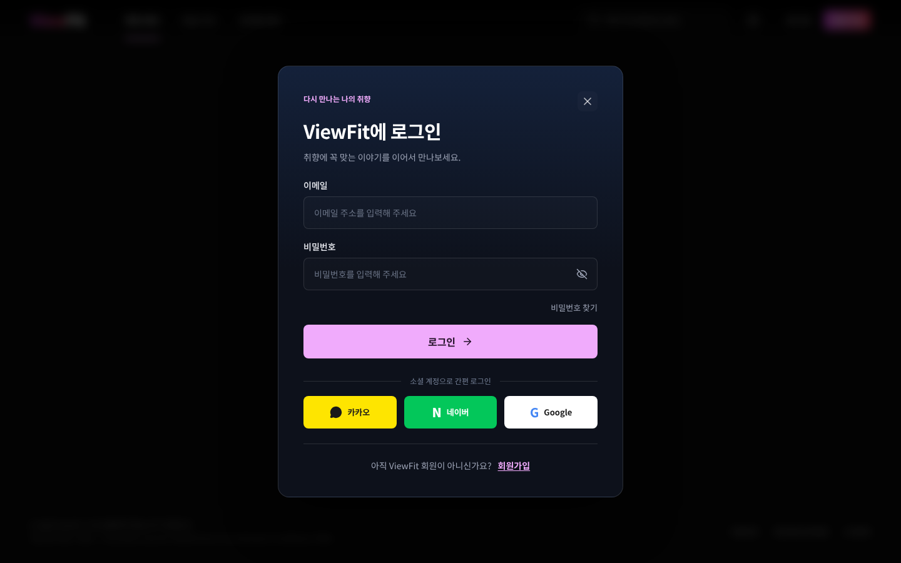
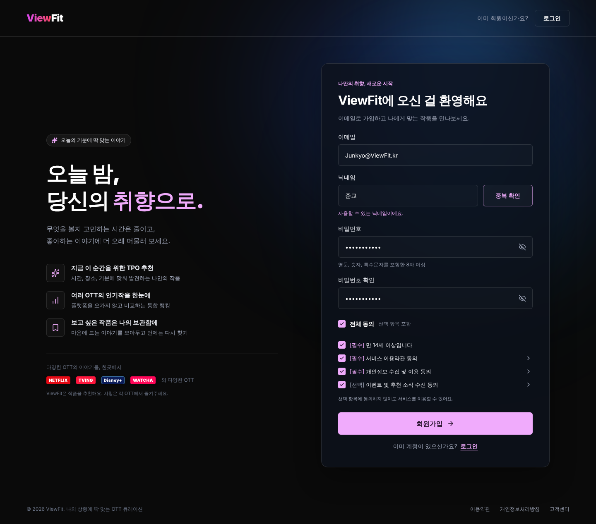
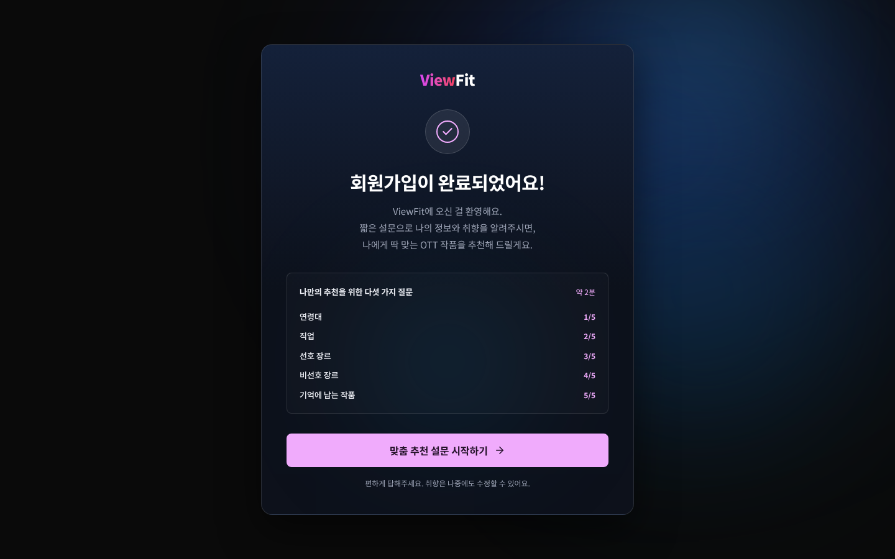

# 1 회원관리 — 프롬프트 사용 기록

- PRD: [docs/prd/1-1_signup.md](../prd/1-1_signup.md), [docs/prd/1-2_login.md](../prd/1-2_login.md)
- 요청·확인: 정준교 / 코드 작성: AI(Claude Code)
- 커밋 주소: `https://github.com/jungyojeong16-arch/team-project/commit/<커밋 번호>`

---

### 기록 1 — 회원가입·로그인·로그아웃·설문 저장 API와 화면 연결
| 칸 | 내용 |
|---|---|
| 날짜 | 11/10 |
| 보낸 프롬프트 | "금일 기준 해야하는 것 목록으로 알려주고 그대로 시작 해보자" |
| 기준 PRD | 1-1 FR1·FR3·FR4·FR5 (가입 API·토큰), 1-2 FR2·FR3 (로그인·설문 여부에 따라 이동), 3-1 FR1~FR3·FR6 (설문 저장) |
| AI가 한 일 | API 8개 (`health`, `options`, 닉네임 확인, 회원가입, 로그인, 로그아웃, 내 정보, 설문 저장), 비밀번호 규칙·이메일 소문자 저장, 자동 테스트 9개, 화면(회원가입·로그인·설문·프로필)과 API 연결, `member.survey_completed_at` 칸 추가 |
| 결과 | 커밋 [`651d70f`](https://github.com/jungyojeong16-arch/team-project/commit/651d70f) · `backend/core/serializers.py`, `views.py`, `urls.py`, `tests.py`, `migrations/0003…`, `app/_lib/account.ts`, `app/login/page.tsx`, `app/signup/page.tsx`, `app/onboarding/page.tsx`, `app/profile/page.tsx` |
| 확인 | - [x] `python manage.py test core` 9개 통과 (SQLite·MariaDB)   - [x] 브라우저 자동 테스트: 가입 → 설문 → DB 저장 → 프로필 → 로그아웃 → 다른 브라우저에서 로그인 → 같은 설문 결과, 틀린 비밀번호·중복 이메일 안내   - [x] 정준교 PC에서 회원가입·프로필, 관리자 계정 로그인 확인 (11/10) |
| 수정 요청 | 없음 |

### 기록 2 — 닉네임 확인 질문 (변경 없음)
| 칸 | 내용 |
|---|---|
| 날짜 | 11/10 |
| 보낸 프롬프트 | "그런데 우리 피그마를 보면 닉네임은 없는데 닉네임은 왜 넣은거야?" |
| 기준 PRD | 1-1 FR2 |
| AI가 한 일 | Figma 회원가입(157:1355)을 확인 → 닉네임 칸과 "중복 확인" 버튼이 **Figma에 있음**. 개념 ERD에는 없어서 물리 설계에서 추가한 것이라고 설명 |
| 결과 | 코드 변경 없음 → 이후 팀 결정 D3 "중복 확인 버튼으로" 로 정리 |
| 확인 | - [x] Figma 확인 |
| 수정 요청 | 없음 |

### 기록 3 — 1-1 회원가입, 1-2 웹 시작 화면·로그인을 Figma와 똑같이
| 칸 | 내용 |
|---|---|
| 날짜 | 11/16 |
| 보낸 프롬프트 | "일단 그럼 저번 주 이후에 시간이 없어서 진도를 나가지 못해서 교수님께서 저번 주에 하라고 하셨던 거 프로그램을 순차적으로 진행하자. 어차피 내가 0~8번까지 하고 결과물만 팀원들한테 봐달라고 하면 되니까" |
| 기준 PRD | **1-1 Step 1** (닉네임 중복 확인 버튼), **1-1 Step 2** (회원가입 완료 안내 화면), **1-1 Step 3** (Figma와 똑같이), **1-2 Step 1** (웹 시작 화면·이메일 기억하기·소셜 "준비 중"), **1-2 Step 2** (로그인 창·로그아웃 메뉴) |
| AI가 한 일 | Figma 회원가입(157:1355)·가입 완료(61:591)·웹 시작 화면(179:1801)·로그인 창(161:1637) 값을 읽어 화면 제작. 로그인 창 입력칸은 팀 결정 D1에 따라 "아이디" 대신 "이메일". 로그인·로그아웃하면 상단 바와 홈이 바로 바뀌도록 계정 변경 신호 추가. 백엔드 없이 볼 때 로그아웃 후 다시 로그인이 안 되던 문제 수정 |
| 결과 | 커밋 [`38b42a3`](https://github.com/jungyojeong16-arch/team-project/commit/38b42a3) · `app/signup/page.tsx`, `app/signup/complete/page.tsx`, `app/login/page.tsx`, `app/_components/start-screen.tsx`, `login-form.tsx`, `login-modal.tsx`, `onboarding-ui.tsx`, `modal.tsx`, `app/_lib/account.ts`, `use-account.ts` |
| 확인 | 브라우저 자동 테스트 (실제 Django API 연결)   - [x] 중복 확인 안 하고 가입 → "닉네임 중복 확인을 해 주세요."   - [x] 새 닉네임 → "사용할 수 있는 닉네임이에요." / 쓰는 닉네임 → "이미 사용 중인 닉네임이에요."   - [x] 가입 → 회원가입 완료 안내 → [맞춤 추천 설문 시작하기]   - [x] 같은 이메일(대소문자 달라도) → "이미 가입된 이메일이에요."   - [x] 틀린 비밀번호 → "이메일 또는 비밀번호가 올바르지 않아요."   - [x] 로그아웃 상태 홈 → 웹 시작 화면, 로그인 상태로 /login → 홈   - [x] 이메일 기억하기 → 다음 로그인 때 이메일 자동 입력   - [x] 상단 바 [로그인] → 로그인 창 → 로그인 → 설문 안 했으면 설문으로   - [x] 카카오 등 → "준비 중이에요"   - [ ] 정재준 화면 검수 |
| 수정 요청 | 없음 |

---

## 1번에서 남은 것
- 정재준: 위 4개 화면을 Figma와 비교 검수
- 소셜 로그인 실제 연동은 P2 (시간이 남으면)
