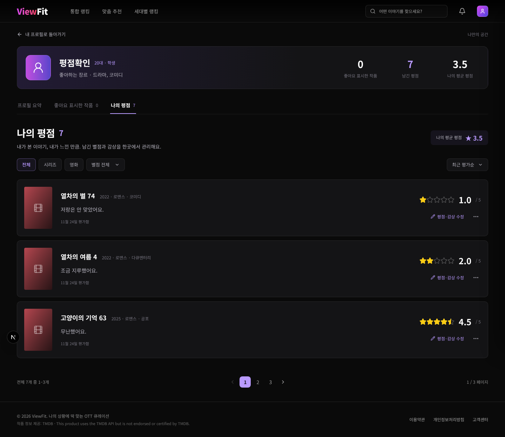
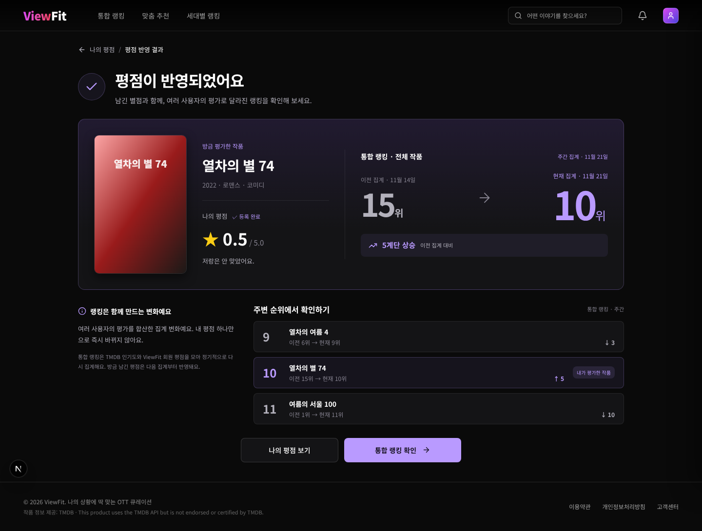

# 5 평가·좋아요 — 프롬프트 사용 기록

- 담당: **정준교** (요청·확인), 코드 작성: AI(Claude Code), 화면 검수: 정재준
- PRD: [5-1 평점](../prd/5-1_rating.md) · [5-2 좋아요](../prd/5-2_like.md)
- 진행 방식: 정준교가 "5-1 시작하자"라고 요청하면, AI가 `CLAUDE.md` 순서대로 작업 일지·PRD를 읽고 **PRD 8번의 Step 1~3 프롬프트를 차례로** 수행했습니다. 아래 '보낸 프롬프트'에는 실제로 보낸 말과 그때 기준으로 삼은 PRD Step 원문을 함께 적었습니다.

---

### 기록 1 — 5-1 Step 1 · 평점 API
| 칸 | 내용 |
|---|---|
| 날짜 | 11/24 |
| 보낸 프롬프트 | 실제로 보낸 말: "5-1 시작하자" → 기준 Step 1 원문: "docs/prd/5-1_rating.md 4번의 API 4개를 만들어 줘. PUT 은 update_or_create 로 한 작품 1개 규칙을 지키고, age_group_at_rating 은 모델 save() 가 채우니 건드리지 마. 나의 평점 목록은 type/score/sort/page(3개씩)를 지원하고, 요약(좋아요 수·평점 수·평균)도 같이 돌려줘. rating-result 는 ranking 의 최근 두 주간 집계에서 순위와 위·아래 1개를 찾아 줘. tests.py 에 '다시 평가하면 수정', '응답 안 함 회원 평점은 세대 NULL', 'TOP 100 밖' 테스트를 추가해 줘." |
| 기준 PRD | 5-1 FR1·FR3·FR4·FR5·FR7, 4번 API 4개, Step 1 |
| AI가 한 일 | `PUT/DELETE /contents/<id>/rating/` (저장은 7-2 와 같은 `common.save_rating`, 입력 검사는 `RatingInputSerializer`), `GET /me/ratings/` (type·score(5/4점대/3점대/2점대/1점대 이하)·sort(최근·별점 높은/낮은 순)·page 3개씩 + 요약), `GET /contents/<id>/rating-result/` (주간 랭킹 최근 두 집계의 순위·변동·위아래 1개) — `backend/core/rating.py` 새로 만듦. 작품 상세 `my` 에 `comment` 추가(팝업 미리 채우기) |
| 결과 | 커밋: `362f0c2`, 파일: `backend/core/rating.py`, `views.py`, `urls.py`, `tests.py` |
| 확인 | - [x] 다시 평가하면 행 1개 그대로 점수만 바뀜, 평가 당시 연령대는 처음 값 유지 - [x] 4.3 · 0 · 5.5 · 201자 → 400, 로그인 안 하면 401 - [x] 연령대 '응답 안 함' 회원 평점은 세대 NULL - [x] 시리즈 + 4점대 필터, 3개씩 페이지, 없는 페이지는 마지막 페이지로 - [x] 반영 결과 순위가 ranking 표와 같음, TOP 100 밖이면 current_rank null - [x] `python manage.py test core` 89개 통과 (MariaDB) |
| 수정 요청 | 없음 (작품 상세 테스트 1개는 `my.comment` 가 추가돼서 기대값을 고침) |

### 기록 2 — 5-1 Step 2 · 별점 입력 부품
| 칸 | 내용 |
|---|---|
| 날짜 | 11/24 |
| 보낸 프롬프트 | 기준 Step 2 원문: "7-2 피드백 팝업과 4-1 상세 팝업에서 같이 쓸 별점 입력 컴포넌트를 app/_components/star-input.tsx 로 만들어 줘. 반 별 클릭, 키보드 좌우 화살표 0.5씩, 감상 200자 + 글자 수 표시. 저장하면 평점 반영 결과 화면으로 이동해." |
| 기준 PRD | 5-1 FR1·FR2, Step 2 |
| AI가 한 일 | 7-2 피드백 팝업 안에 있던 별 입력을 `StarInput` 으로 옮겨 공용화(7-2 팝업은 같은 모양 그대로), 별점·감상 팝업 `RatingDialog` 추가 — 저장하면 `/me/ratings/result/{id}` 로 이동, 로그인 안 했으면 로그인 창 |
| 결과 | 커밋: `362f0c2`, 파일: `app/_components/star-input.tsx`, `app/_components/feedback-modal.tsx`, `app/_lib/rating.ts` |
| 확인 | - [x] 반 별 클릭, ←→ 0.5씩, 200자 글자 수 - [x] [수정하기] → 반영 결과 화면 이동 (브라우저) |
| 수정 요청 | 없음 |

### 기록 3 — 5-1 Step 3 · 나의 평점·반영 결과 화면
| 칸 | 내용 |
|---|---|
| 날짜 | 11/24 |
| 보낸 프롬프트 | 기준 Step 3 원문: "Figma 노드 220:2672 "나의 평점" 을 app/me/ratings/page.tsx 로, Figma 노드 224:4225 "평점 반영 결과 · 랭킹 변화" 를 app/me/ratings/result/[id]/page.tsx 로 만들어 줘. '예시 데이터' 문구는 지우고, FR8 안내 문구는 그대로 둬. 프로필 메뉴의 '나의 평점' 과 연결해 줘." |
| 기준 PRD | 5-1 FR5~FR8, Step 3 |
| AI가 한 일 | 마이페이지 공통 머리 `ProfileHeader`(이름·연령대·직업, 좋아요·평점 수·평균, 탭 3개 — 5-2·8-1 도 사용), 나의 평점 화면(전체/시리즈/영화 · 별점 · 정렬 · 카드 3개 · 페이지 번호 · [평점·감상 수정] · [⋯] 삭제), 평점 반영 결과 화면(이전/현재 집계 순위, N계단 상승, 주변 순위, FR8 안내). `Pagination` 에 현재 페이지 색을 바꾸는 선택 옵션 추가 |
| 결과 | 커밋: `362f0c2`, 화면: 아래 캡처 (로컬 테스트 데이터) |
| 확인 | - [x] 로그인 → 나의 평점 → 시리즈 + 4점대 → 3개 맞게 걸림 - [x] 수정 → 반영 결과 화면, 순위가 DB ranking 표(11/14 15위 → 11/21 10위)와 같음 - [x] 휴대폰 폭(390px)에서 가로 넘침 없음 - [ ] 정재준 화면 검수 |
| 수정 요청 | 없음 |

Figma 와 다른 점
- 이름 아래 한 줄: Figma 의 예시 문구("과제 끝나면, 좋은 이야기 한 편.") 대신 설문의 **좋아하는 장르**를 보여 줌 (회원마다 다른 실제 데이터)
- '예시 데이터' 문구 3곳은 지우고, 그 자리에 **집계일**(예: 주간 집계 · 11월 21일)을 보여 줌 (PRD 5번)
- 별점·정렬 드롭다운은 브라우저 기본 선택 상자(모양은 Figma 버튼과 같게)

