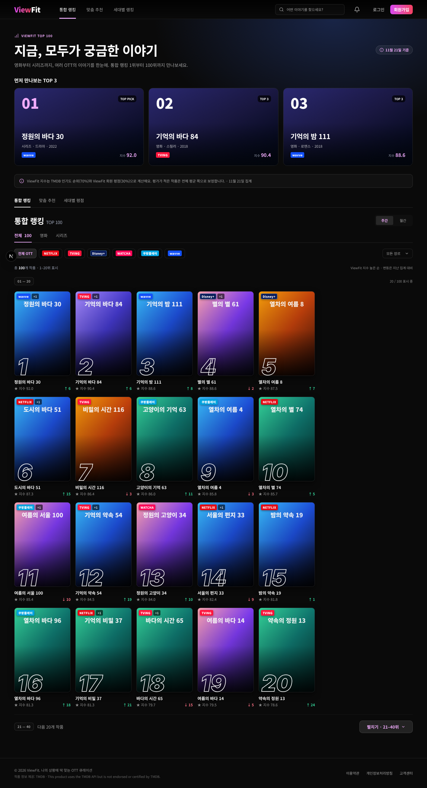

# 6 랭킹 — 프롬프트 사용 기록

- PRD: [docs/prd/6-1_total_ranking.md](../prd/6-1_total_ranking.md), [docs/prd/6-2_generation_ranking.md](../prd/6-2_generation_ranking.md)
- 요청·확인: 정준교 / 코드 작성: AI(Claude Code)

---

### 기록 1 — 6-1 Step 1 (ranking.score 칸)
0번 기록 7(11/17, D7 반영)과 같은 작업입니다 → [0_common_base.md 기록 7](0_common_base.md)

### 기록 2 — 6-1 Step 2~4 (집계 명령 · 랭킹 API · 화면)
| 칸 | 내용 |
|---|---|
| 날짜 | 11/21 |
| 보낸 프롬프트 | "저번에 한 이후 금일까지 아무것도 못했는데 오늘 좀 하려고 해. 남은 부분 할 수 있게 해줘." → AI가 일정표에서 밀린 6-1(11/20)을 골라 PRD Step 프롬프트대로 진행 |
| 기준 PRD | **6-1 Step 2** ("docs/prd/6-1_total_ranking.md 의 FR8 과 'ViewFit 지수 계산' 을 구현해 줘. build_rankings 명령이 TMDB 인기도(2-1 의 tmdb.py 사용)와 rating 평균으로 지수를 계산해 상위 100개를 저장하게 해 줘. --date 옵션으로 집계일을 바꿀 수 있게 해서 변동 테스트가 가능하게 해 줘. tests.py 에 '두 날짜 집계 → 변동·NEW 계산' 테스트를 추가해 줘.") · **6-1 Step 3** ("docs/prd/6-1_total_ranking.md 4번의 GET /api/v1/rankings/ 를 만들어 줘. 필터를 걸면 조건에 맞는 작품만 1부터 다시 번호를 매기고, rank_change 는 전체 순위 기준으로 계산해. offset/limit 으로 20개씩 받을 수 있게 해 줘.") · **6-1 Step 4** ("Figma 노드 144:6421 "통합 랭킹" 을 app/ranking/page.tsx 로 만들어 줘. 주간/월간 탭, 필터(영화·시리즈, OTT, 장르), TOP 3 카드, 1–20위 목록, [펼치기]로 20개씩, [맨 위로]. '샘플' 문구는 'ViewFit 지수 · {집계일} 기준' 으로 바꾸고, 작품을 누르면 4-1 상세 팝업을 열어 줘. 상단 메뉴 '통합 랭킹' 과 홈의 [전체보기] 를 이 페이지로 연결해 줘.") |
| AI가 한 일 | 지수 계산·저장·순위 변동(`backend/core/ranking.py`), 집계 명령 `build_rankings`(`--period`·`--date`·`--offline`, TMDB 실패 시 TMDB 평가 수로 대신), `GET /api/v1/rankings/`, 화면 `/ranking`(Figma 144:6421 — 0-3 공통 부품 사용, 한 줄 5장), 홈 TOP 10을 주간 랭킹으로 교체. PRD에 정해지지 않았던 것: 주간 = 최근 7일 평점·월간 = 최근 30일 평점, 첫 집계는 변동 '—' 로 정하고 PRD에 적음 |
| 결과 | 커밋 [`8804b70`](https://github.com/jungyojeong16-arch/team-project/commit/8804b70) · `backend/core/ranking.py`, `management/commands/build_rankings.py`, `views.py`, `urls.py`, `home.py`, `tests.py`, `app/_lib/ranking.ts`, `app/ranking/page.tsx` |
| 확인 | 자동 테스트 12개 + 브라우저(가짜 작품 120개·가상 평점으로)   - [x] `build_rankings` → `ranking` 100행   - [x] 다른 날짜로 다시 집계 → ↑n ↓n NEW   - [x] 같은 날 다시 집계 → 덮어씀(100행 그대로)   - [x] 영화 + 넷플릭스 → 17개, 1위부터 다시 번호   - [x] [펼치기] → 21–40위   - [x] 작품 클릭 → 상세 팝업   - [x] `python manage.py test core` 51개 통과 (SQLite·MariaDB)   - [x] 정준교 PC에서 실제 TMDB 작품으로 확인 (11/21 — 통합 랭킹 TOP 10과 홈 TOP 10이 같음)   - [ ] 정재준 화면 검수 |
| 수정 요청 | Figma는 한 줄에 카드 5장 → 6장으로 나와서 5장으로 맞춤 · 정준교 PC에서 홈이 "HTTP 401"로 멈춤(DB를 새로 만들어 예전 로그인 토큰이 없어짐) → 401이면 로그인 정보를 지우고 시작 화면으로 가도록 수정 [`be7cc12`](https://github.com/jungyojeong16-arch/team-project/commit/be7cc12) |

